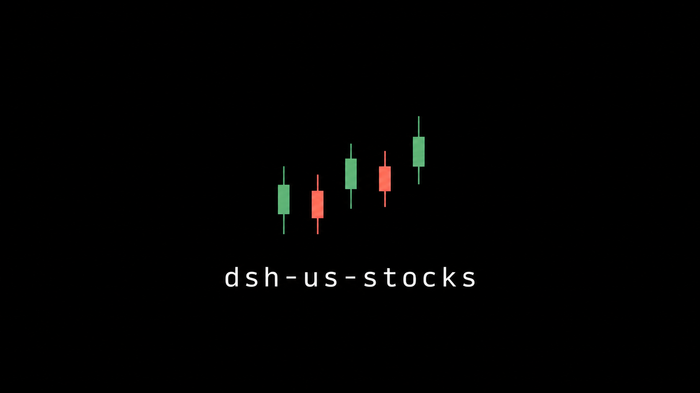
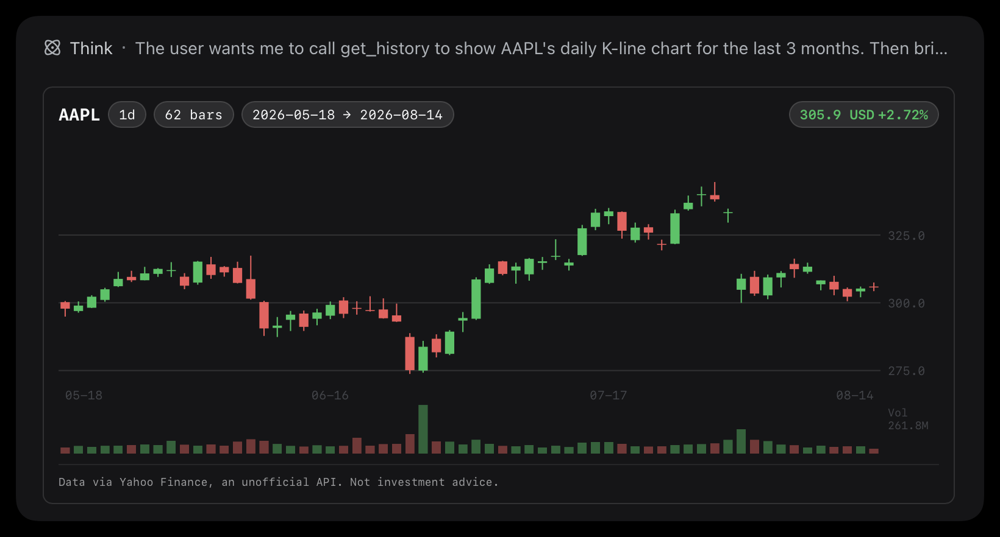

# dsh-us-stocks

English | [中文](README.zh.md)

<p align="center">
  
</p>

US stock market data tools for [DeepSeek Harness](https://github.com/deepseek-ai/deepseek-harness), powered by [yahoo-finance2](https://github.com/gadicc/yahoo-finance2).

Gives the agent five first-class tools for quotes, price history, financial statements, analyst consensus and news — instead of leaving it to improvise against HTML pages.

<p align="center">
  
</p>

## Before and after

One agent turn, same question, same model, same machine — the only variable is whether the plugin is installed. The task: *price, three-month trend, recent quarterly financials, analyst rating and recent news for AAPL.*

| | Without this plugin | With this plugin |
|---|---|---|
| Steps | 14 | 2 |
| Tool calls | 31 | 5 |
| Wall clock | 213.5s | 33.2s |
| What it called | 16 × `web_search`, 15 × `bash` | one call to each of the five tools |

With no market-data tool available, the agent falls back on web search and shell commands, fetching and parsing one page at a time.

Most of the remaining 33 seconds is model inference, which no plugin controls. Data retrieval itself is 2.6s:

```
Acceptance benchmark — AAPL

  ✅ get_quote           2092ms  305.26 USD (+0.9959%), mcap 4455.02B
  ✅ get_history          437ms  63 bars 2026-05-14..2026-08-13
  ✅ get_financials      2255ms  4 income / 4 balance / 4 cash-flow periods
  ✅ get_analyst_view    2557ms  buy from 41 analysts, target 322.2844
  ✅ get_news             974ms  8 headlines, latest "Tim Cook’s Final Act: A $60 Billion Bet On Texa…"

  tool calls        5
  wall clock        2.56s (concurrent)
  payload           22.0 KiB across 5 results
```

Reproduce with `npm run benchmark`, optionally against another ticker: `npm run benchmark -- TTMI`.

## Install

### The lazy way

Say it to your DeepSeek Harness:

```
Install this plugin: https://github.com/Realyujie/dsh-us-stocks
```

The agent reads this README and runs the command itself. It will ask for filesystem permission on the way, because the profile directory sits outside the session workspace.

### By hand

If `dsh` is on your `PATH`:

```bash
dsh plugin --profile web add dsh-us-stocks
```

If it is not — which is the case when Harness was started through `npx`, since the binary then only exists in the npx cache — call it through `npx` instead:

```bash
npx @deepseek-ai/dsh plugin --profile web add dsh-us-stocks
```

Every command below works the same way: prefix it with `npx @deepseek-ai/dsh` in place of `dsh`, or install the CLI globally once with `npm install -g @deepseek-ai/dsh` and use the short form throughout.

To update later:

```bash
dsh plugin --profile web update dsh-us-stocks
```

Restart the profile afterwards — plugins are resolved when the tree is composed at boot.

For local development, point the profile at a checkout instead. Changes take effect after `npm run build` and a restart:

```bash
dsh plugin --profile web add link:/absolute/path/to/dsh-us-stocks
```

`dsh plugin` forwards to pnpm inside the profile directory and keeps the profile's `dsh.profile.bundles` list in step, so no manual registration is needed.

The plugin registers server-side agent tools. It also ships a small browser half that draws the candlestick chart described under `get_history`; in a TUI or headless profile that half is simply absent and every tool still works.

## Tools

| Tool | Returns |
|---|---|
| `get_quote` | Last price, change, day range, volume, market cap, P/E, EPS, book value, dividend yield, 52-week range, moving averages, last and next earnings dates. For an ETF or mutual fund, also expense ratio, net assets, category, allocation, trailing returns and top holdings |
| `get_history` | Daily/weekly/monthly OHLCV bars with adjusted close, plus dividends and splits in the window, as structured data points |
| `get_financials` | Income statement, balance sheet and cash flow line items, quarterly or annual, with the reporting currency and trailing-twelve-month ratios |
| `get_analyst_view` | Consensus rating, buy/hold/sell counts by month, price targets, forward EPS and revenue estimates, recent broker upgrades and downgrades, EPS beat/miss history |
| `get_news` | Recent headlines with publisher, timestamp and link |

### `get_quote`

| Parameter | Type | Notes |
|---|---|---|
| `ticker` | string, required | e.g. `AAPL`, `BRK-B` |

Earnings dates are reported as `last_earnings_date` and `next_earnings_date` separately, because upstream conflates them in one field. `next_earnings_date_is_estimate` marks a date projected from the reporting cadence rather than confirmed by the company. Across a ten-ticker sample it was true half the time, so it is worth checking rather than assuming either way.

`currency` is what the stock trades in; `financial_currency` is what the company reports in. They differ for ADRs, and only the latter applies to the figures in `get_financials`.

Analyst ratings are deliberately not part of this tool even though upstream returns one. Consensus ratings and price targets live in `get_analyst_view`, so a caller that only wants market data never has a recommendation put in front of it.

**ETFs and mutual funds** additionally return `fund_expense_ratio_percent` (with the category average beside it), `fund_total_assets`, `fund_category`, `fund_family`, `fund_asset_allocation_percent`, `fund_trailing_returns_percent` and `fund_top_holdings`. Those come from a second upstream call made only when the quote says the symbol is a fund, so an equity pays nothing for them; a fund quote costs roughly three times an equity one. If that call fails the quote is still returned, with a warning.

Three things about the fund fields are stated in a `fund_notes` block in the response itself, rather than only here, because whatever reads the numbers is reading the response:

- `trailing_pe`, `price_to_book`, `book_value_per_share` and `eps_trailing_twelve_months` are holdings-weighted aggregates for a fund, not one company's figures. Left unlabelled, they get read as a valuation judgement on the fund.
- The expense ratio is passed through as reported and is occasionally wrong — FXAIX was observed at 0.42% against a true 0.015%.
- `fund_trailing_returns_percent` switches convention partway through, as upstream does: `ytd` through `one_year` are returns over that window, while `three_year_annualized`, `five_year_annualized` and `ten_year_annualized` are annualised. The keys say which, because the two differ by a factor of four over five years.
- `fund_top_holdings` is capped at ten positions upstream, so `fund_top_holdings_coverage_percent` states how much of the fund they add up to. That share ranges from 14% (VXUS) to 73% (XLE) across the funds sampled, and fund-to-fund overlap cannot be computed from a partial list. Bond, commodity and inverse funds report no positions at all; the field is then absent rather than empty.

### `get_history`

| Parameter | Type | Notes |
|---|---|---|
| `ticker` | string, required | |
| `range` | enum | `5d` `1mo` `3mo` `6mo` `1y` `2y` `5y` `10y` `max`. Default `1y` |
| `start_date` / `end_date` | string | `yyyy-MM-dd`; `start_date` overrides `range` |
| `interval` | enum | `1h` `1d` `1wk` `1mo`. Default `1d`. One call covers ~5 weeks at `1h`, ~2 years at `1d`, ~8 at `1wk`, ~35 at `1mo` |
| `limit` | integer | Keep the most recent N bars, 1–500. Defaults to every bar in the window |

Bars are ordered oldest to newest. `date` is `yyyy-MM-dd` for `1d`/`1wk`/`1mo`, and a full ISO instant for `1h` — several bars share a calendar day at that granularity, so a date-only label would print the same value for all of them.

`interval: "1h"` is separately capped by the upstream source at about 730 days of history, regardless of the requested window. A `range` or `start_date` older than that fails with `invalid_argument` rather than the truncation warning the other intervals get, since Yahoo refuses the request outright instead of returning a partial one.

In the Web UI the call renders as a candlestick chart — bodies, wicks, a volume band, price gridlines and per-bar OHLC on hover — drawn from the same payload the model receives, so the picture and the numbers cannot disagree. Colours follow the host theme, green rising and red falling. Chart labels follow the host language, English or Chinese; messages from the data source are shown verbatim, since they are written for the model as well as the reader. Elsewhere the call shows the host's generic result card; the tool's output is identical either way.

Every response carries a `chart_note` explaining this, because the model reads the returned data when deciding what to do next, not the tool description it read at call time. Without it, a model that got a chart in the Web UI has been observed spending a minute installing `matplotlib` into a virtualenv to build a second one, unaware the request was already satisfied.

Dividends and splits falling inside the returned window come back as `dividends` and `splits`; both keys are absent for symbols that have never paid or split.

**The two price bases are not interchangeable.** `open`/`high`/`low`/`close` are adjusted for splits only; `adj_close` is adjusted for splits *and* dividends. Over 2019–2026, 91 of 93 AAPL monthly bars have `close ≠ adj_close`, so mixing them in one calculation is quietly wrong. Every response states this in `price_adjustment`.

Bars are trimmed to fit the output budget rather than to a fixed count, since a bar costs 117–127 characters depending on price magnitude and interval. In practice a request for `max` returns 266–489 bars. When trimming happens, the warning names the next coarser interval to use for the full span.

### `get_financials`

| Parameter | Type | Notes |
|---|---|---|
| `ticker` | string, required | |
| `period` | enum | `quarterly` (default) or `annual` |
| `statements` | array | Any of `income` `balance` `cash_flow`. Default all three |
| `limit` | integer | Most recent N periods, 1–8. Default 4 |
| `detail` | enum | `summary` (default, headline line items) or `full` (every reported field) |

Upstream depth is fixed and cannot be widened by asking for an earlier start: about 5 periods of income statement and cash flow, 7 of balance sheet, quarterly or annual alike.

Every response carries `reporting_currency`. **This is not always USD.** An ADR files in its home currency while trading in dollars — TSM in TWD, SAP in EUR, BABA in CNY, NVO in DKK — so raw revenue is off by ~32x for TSM against a USD filer. If the currency cannot be determined the statements are still returned, with a warning not to assume USD.

A full trailing-twelve-month *statement* is not available: the upstream `trailing` period type returns `periodType: "TTM"`, which fails `yahoo-finance2`'s schema validation, and reading it would mean disabling result validation wholesale. TTM *aggregates* — revenue, gross profit, EBITDA, free cash flow and the margin, return, growth and leverage ratios — do come back, in the `ratios` block.

Margins, returns and growth rates in `ratios` are unitless fractions (`0.27` means 27%). `debt_to_equity_percent` is the exception: Yahoo scales it by 100, so AAPL's 0.784x arrives as `78.445`. It keeps the upstream value and carries the unit in its name rather than being silently rescaled.

### `get_analyst_view`

| Parameter | Type | Notes |
|---|---|---|
| `ticker` | string, required | |

**`recommendation_mean` runs 1–5 where 1 is Strong Buy and 5 is Strong Sell** — a lower number is more bullish, which reads backwards if taken as a score out of five. Each response repeats the scale in `recommendation_mean_scale` rather than relying on the reader to know it.

Period codes count away from now in opposite directions: `recommendation_trend` uses `0m` for this month and `-1m` for last month, while `estimates` uses `0q`/`+1q` for the current and next quarter and `0y`/`+1y` for the current and next fiscal year. `earnings_surprises` uses `-1q` for the most recently reported quarter.

`rating_changes` keeps the ten most recent broker actions, newest first; upstream holds hundreds. `action` is `up`, `down`, `main` (reiterated) or `init` (coverage initiated).

Prices here are in the trading currency (USD for US listings) even when the company reports in another — unlike the statement figures in `get_financials`.

ETFs and funds return `no_data`: analysts rate individual companies, so a fund never carries a rating, a price target or an EPS estimate. Fund detail belongs to `get_quote`.

### `get_news`

| Parameter | Type | Notes |
|---|---|---|
| `ticker` | string, required | |
| `limit` | integer | 1–10. Default 10 |

Headline metadata only. Article bodies are not fetched. Upstream returns at most 10 headlines regardless of what is requested, so 10 is both the default and the ceiling.

**Only headlines that actually reference the symbol are returned.** The upstream news search matches text, so a ticker that is also an ordinary word pulls in unrelated stories — searching `ALL` returned a Finnish bank's tender offer and a mineral resource update, `KEY` returned UK property filings, none of which mention Allstate or KeyCorp. Results are filtered against each article's related-tickers list, and when the symbol pass comes up short the company name is searched as well. That recovered `ALL` from 0 of 6 relevant to 6 of 6, and `KEY` likewise. The number of discarded headlines is reported as a warning; if every match is noise the tool fails with `no_data` and says so, rather than returning plausible-looking articles about other companies.

## Response shape

Every tool returns a JSON string with a consistent envelope.

Success:

```json
{
  "ok": true,
  "market": "us",
  "ticker": "AAPL",
  "as_of": "2026-08-14T09:28:31.204Z",
  "data": { "…": "…" },
  "warnings": ["Returned the most recent 455 of 11509 bars, the most that fits the tool output budget. …"]
}
```

Failure — never a bare exception:

```json
{
  "ok": false,
  "market": "us",
  "ticker": "ZZZZ",
  "error": {
    "kind": "unknown_symbol",
    "retryable": false,
    "message": "No quote data for symbol \"ZZZZ\"."
  }
}
```

`retryable` is the field that matters to the model. It separates "this ticker genuinely has no such data, stop asking" from "the upstream hiccuped, the same call may work shortly".

| `kind` | `retryable` | Meaning |
|---|---|---|
| `unknown_symbol` | no | Symbol does not resolve to any instrument |
| `no_data` | no | Symbol is valid but this dataset is absent (ETFs file no income statement) |
| `invalid_argument` | no | Argument the tool cannot honour |
| `upstream_unavailable` | yes | Upstream refused or errored transiently |
| `rate_limited` | yes | Upstream throttled the request |
| `timeout` | yes | Deadline or caller cancellation fired |
| `response_too_large` | yes | Payload exceeded the output budget even after the envelope was stripped |
| `internal` | no | Unclassified |

Results above 64,000 characters are truncated: `data` is dropped, the envelope is preserved, and `output_truncated` plus `original_characters` tell the model to retry with a narrower query. `get_history`, whose payload scales with the requested window, trims its own bars against the measured size first, so it reaches that fallback only in pathological cases.

## Configuration

```yaml
enabled: true          # register the tools
market: us             # only "us" today
quoteTtlMs: 10000      # live quote cache lifetime
referenceTtlMs: 300000 # statements, bars, ratings and news cache lifetime
```

Caching is in-memory and per-process. Concurrent identical requests are collapsed onto a single upstream call, so an agent fanning five tools at one ticker does not make five redundant round trips. Failures are never cached.

## Development

```bash
npm install
npm run typecheck
npm test            # unit tests, no network
npm run build
npm run test:live   # live smoke test against Yahoo, needs network
npm run benchmark   # AAPL acceptance benchmark
```

Requires Node >= 22.19.0.

### Layout

```
src/
├── index.ts                    apply(ctx, config) entry point
├── config.ts                   schemastery config, incl. the market enum
├── datasource/us/
│   └── yahoo-client.ts         yahoo-finance2 wrapper: caching, cancellation, error typing
├── tools/                      one file per tool, plus shared shaping helpers
├── client/                     browser half: the candlestick card for get_history
└── util/
    ├── cache.ts                short-TTL cache with in-flight de-duplication
    ├── errors.ts               failure taxonomy and envelopes
    └── stringify.ts            output budget enforcement
```

Only US equities are supported. The `datasource/<market>/` split, the `market` config enum and the opaque handling of `ticker` exist so another venue can be added without reshaping the plugin — but nothing else is implemented today.

## Notes on the data source

Financial statements come from Yahoo's `fundamentalsTimeSeries` endpoint rather than the `quoteSummary` statement modules. Since late 2024 those modules return only a handful of income-statement fields and lag by a reporting period; for AAPL they gave 9 populated fields ending 2026-03-31, against 35 ending 2026-06-30 from the endpoint used here.

This is an unofficial, undocumented API. It can change without notice, and it is rate-limited. Data is provided as-is for research; it is not investment advice.

## License

MIT
