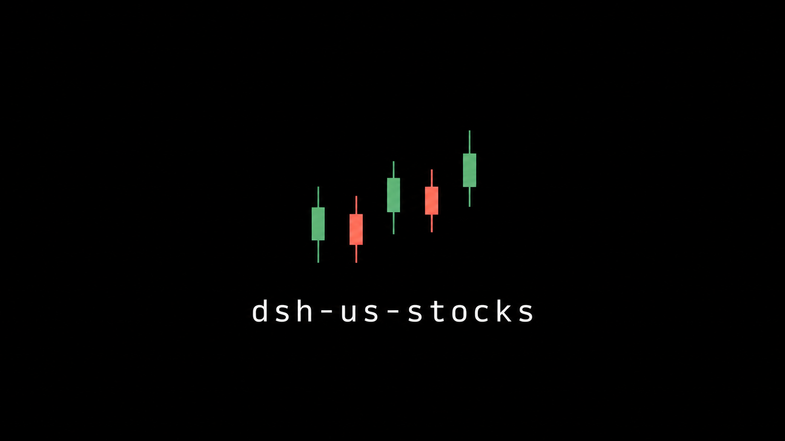
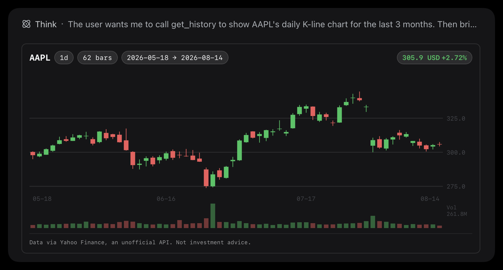

# dsh-us-stocks

[English](README.md) | 中文

<p align="center">
  
</p>

给 [DeepSeek Harness](https://github.com/deepseek-ai/deepseek-harness) 用的美股行情数据插件，基于 [yahoo-finance2](https://github.com/gadicc/yahoo-finance2)。

提供行情、历史 K 线、财务报表、分析师共识、新闻、股东结构六个专用工具，无需模型自行解析网页。

<p align="center">
  
</p>

## 效果对比

下表为同一任务在装载与未装载本插件两种条件下的实测结果，模型与运行环境一致。任务内容：*AAPL 的现价、近三个月走势、最近几个季度财务、分析师评级和近期新闻。*


|      | 未装载本插件                        | 装载本插件   |
| ---- | ----------------------------- | ------- |
| 步骤   | 14 步                          | 2 步     |
| 工具调用 | 31 次                          | 5 次     |
| 整体耗时 | 213.5 秒                       | 33.2 秒  |
| 调用构成 | 16 次 `web_search`、15 次 `bash` | 五个工具各一次 |


在缺少行情数据工具的情况下，模型只能依靠网页搜索与 shell 命令，逐个页面抓取并解析。

其余 33 秒主要为模型推理耗时，不在本插件的作用范围内。数据获取本身占 2.6 秒：

```
Acceptance benchmark — AAPL

  ✅ get_quote           2092ms  305.26 USD (+0.9959%), mcap 4455.02B
  ✅ get_history          437ms  63 bars 2026-05-14..2026-08-13
  ✅ get_financials      2255ms  4 income / 4 balance / 4 cash-flow periods
  ✅ get_analyst_view    2557ms  buy from 41 analysts, target 322.2844
  ✅ get_news             974ms  8 headlines, latest "Tim Cook’s Final Act: A $60 Billion Bet On Texa…"

  tool calls        5
  wall clock        2.56s (concurrent)
  payload           22.0 KiB across 5 results
```

可用 `npm run benchmark` 自行复现，亦可指定其他标的：`npm run benchmark -- TTMI`。

## 安装


### 懒人版

直接对你的 DeepSeek Harness 说：

```
安装一下这个插件：https://github.com/Realyujie/dsh-us-stocks
```

它会读这份 README 并自行执行安装命令。过程中会请求文件系统权限，因为 profile 目录在会话工作区之外。

### 手动安装

若 `dsh` 已在 `PATH` 中：

```bash
dsh plugin --profile web add dsh-us-stocks
```

若不在——通过 `npx` 启动 Harness 时即属此种情况，因为可执行文件只存在于 npx 缓存中——改用 `npx` 调用：

```bash
npx @deepseek-ai/dsh plugin --profile web add dsh-us-stocks
```

下文所有命令同理：把 `dsh` 换成 `npx @deepseek-ai/dsh` 前缀即可；或用 `npm install -g @deepseek-ai/dsh` 全局安装一次，之后统一使用简写形式。

后续更新：

```bash
dsh plugin --profile web update dsh-us-stocks
```

更新后需重启 profile——插件是在启动时组装插件树的过程中解析的。

本地开发则让 profile 指向检出目录，改动在 `npm run build` 并重启后生效：

```bash
dsh plugin --profile web add link:/absolute/path/to/dsh-us-stocks
```

`dsh plugin` 是转发给 profile 目录下的 pnpm，并会同步维护 profile 的 `dsh.profile.bundles` 列表，不需要手动注册。

本插件注册服务端的 agent 工具，同时附带一个很小的浏览器半边，用于绘制 `get_history` 一节所述的 K 线图；在 TUI 或 headless profile 下该半边不存在，五个工具照常可用。

## 工具


| 工具                 | 返回内容                                                     |
| ------------------ | -------------------------------------------------------- |
| `get_quote`        | 最新价、涨跌、日内区间、成交量、市值、市盈率、每股收益、每股净资产、股息率、52 周区间、均线、上次和下次财报日。ETF 与共同基金另有费率、规模、分类、资产配置、滚动收益与前十大持仓 |
| `get_history`      | 日/周/月 K 线 OHLCV 及复权收盘价，附窗口内的分红与拆股，纯结构化数据                 |
| `get_financials`   | 利润表、资产负债表、现金流量表科目，季度或年度，含报表货币与 TTM 比率                    |
| `get_analyst_view` | 共识评级、逐月买入/持有/卖出家数、目标价、EPS 与营收预期、近期券商评级变动、EPS 超预期记录       |
| `get_news`         | 近期新闻标题，含发布方、时间和链接                                        |
| `get_ownership`    | 内部人与机构持股比例、最大机构与基金股东（含季度仓位变动）、内部人近六个月买卖汇总 |


### `get_quote`


| 参数       | 类型        | 说明                |
| -------- | --------- | ----------------- |
| `ticker` | string，必填 | 例如 `AAPL`、`BRK-B` |


财报日期拆成 `last_earnings_date` 和 `next_earnings_date` 两个字段返回，因为上游将二者合并在同一字段中。`next_earnings_date_is_estimate` 用于标记该日期为按财报节奏推算所得，而非公司正式确认。在十个标的的抽样中约有一半为预估值，建议读取该字段确认，不宜直接假定。

`currency` 是股票的交易货币，`financial_currency` 是公司的报表货币。ADR 的这两者不一致，而 `get_financials` 中的数字仅以后者计价。

上游虽然返回了分析师评级，本工具有意不包含该字段。共识评级与目标价统一由 `get_analyst_view` 提供，使仅需行情数据的调用方不会一并收到投资建议。

**ETF 与共同基金**会额外返回 `fund_expense_ratio_percent`（并附同类均值）、`fund_total_assets`、`fund_category`、`fund_family`、`fund_asset_allocation_percent`、`fund_trailing_returns_percent` 和 `fund_top_holdings`。这些来自第二次上游请求，仅在行情确认该标的为基金后才发出，个股不承担任何额外开销；基金的一次查询耗时约为个股的三倍。该请求失败时仍返回行情本体，并附一条 warning。

关于基金字段有三点写在响应内的 `fund_notes` 里，而不只写在这里——因为读这些数字的对象读的是响应：

- 对基金而言，`trailing_pe`、`price_to_book`、`book_value_per_share`、`eps_trailing_twelve_months` 是成分股的加权聚合值，不是某一家公司的数据。不加标注时会被当成对该基金的估值判断。
- 费率按上游原样透传，偶有错误——实测 FXAIX 报 0.42%，实际为 0.015%。
- `fund_trailing_returns_percent` 沿用上游的混合口径:`ytd` 到 `one_year` 是区间收益,而 `three_year_annualized`、`five_year_annualized`、`ten_year_annualized` 是年化值。字段名直接标明口径 —— 五年期这两种口径能差出四倍。
- `fund_top_holdings` 受上游限制最多 10 条，因此以 `fund_top_holdings_coverage_percent` 说明这些持仓合计占基金的比例。实测该比例从 VXUS 的 14% 到 XLE 的 73% 不等，无法据此计算两只基金之间的重叠度。债券、商品与反向基金完全不返回持仓，此时该字段直接缺失而非为空。

### `get_history`


| 参数                        | 类型        | 说明                                                                                  |
| ------------------------- | --------- | ----------------------------------------------------------------------------------- |
| `ticker`                  | string，必填 |                                                                                     |
| `range`                   | 枚举        | `5d` `1mo` `3mo` `6mo` `1y` `2y` `5y` `10y` `max`，默认 `1y`                           |
| `start_date` / `end_date` | string    | `yyyy-MM-dd`，指定 `start_date` 时覆盖 `range`                                            |
| `interval`                | 枚举        | `1h` `1d` `1wk` `1mo`，默认 `1d`。单次调用 `1h` 约覆盖 5 周，`1d` 约 2 年，`1wk` 约 8 年，`1mo` 约 35 年 |
| `limit`                   | 整数        | 保留最近 N 根，1–500。默认返回窗口内全部                                                            |


K 线按时间从旧到新排列。`1d`/`1wk`/`1mo` 的 `date` 是 `yyyy-MM-dd`；`1h` 则是完整 ISO 时间戳——这个粒度下同一天会有多根 K 线，若只保留日期会让它们的标签全部相同。

`interval: "1h"` 另受上游限制，历史最多回溯约 730 天，与请求窗口大小无关。`range` 或 `start_date` 超出这个范围会直接返回 `invalid_argument`，而不是其他档位那种"已裁剪"的警告——因为 Yahoo 对此是直接拒绝整个请求，而非退而求其次给一部分数据。

在 Web UI 中，该调用会渲染成 K 线图——蜡烛实体、上下影线、成交量副图、价格网格线，鼠标悬停显示当根 OHLC——所用数据与模型收到的完全是同一份，因此图与数字不会出现分歧。配色跟随宿主主题，绿涨红跌。图表文案跟随宿主语言（中文或英文）；来自数据源的消息按原文显示，因为那些文字同时也是写给模型看的。在其他客户端则显示宿主的通用结果卡片，工具输出本身没有区别。

每次响应都带一条 `chart_note` 说明这件事——因为模型决定下一步做什么时读的是返回的数据，而不是调用时读过的工具描述。没有这条提示时，实测出现过模型在 Web UI 里已经拿到图表、却毫不知情，转身花了一分钟装 `matplotlib`、建虚拟环境，想再画一张。

落在返回窗口内的分红和拆股以 `dividends`、`splits` 返回；从未分红或拆股的标的不会出现这两个键。

**两套价格基准不可混用。** `open`/`high`/`low`/`close` 只做了拆股复权，`adj_close` 则同时做了拆股和分红复权。2019–2026 年间 AAPL 的 93 根月线里有 91 根 `close ≠ adj_close`，在同一计算中混用会得出错误结果且不会报错。每次响应均在 `price_adjustment` 中标明这一区别。

K 线是按输出预算实测裁剪的，而不是按固定根数——单根成本随价格量级和 interval 在 117–127 字符间浮动。实际请求 `max` 会返回 266–489 根。发生裁剪时，警告中会指明应改用的下一档 interval。

### `get_financials`


| 参数           | 类型        | 说明                                         |
| ------------ | --------- | ------------------------------------------ |
| `ticker`     | string，必填 |                                            |
| `period`     | 枚举        | `quarterly`（默认）或 `annual`                  |
| `statements` | 数组        | `income` `balance` `cash_flow` 任意组合，默认返回三张 |
| `limit`      | 整数        | 最近 N 期，1–8，默认 4                            |
| `detail`     | 枚举        | `summary`（默认，核心科目）或 `full`（全部上报字段）         |


上游可提供的期数是固定的，将起始日期前移也无法增加：利润表和现金流约 5 期，资产负债表 7 期，季度年度皆然。

每次响应均包含 `reporting_currency`。**它不一定是美元。** ADR 用本国货币编制报表却以美元交易——台积电用 TWD、SAP 用 EUR、阿里用 CNY、诺和诺德用 DKK——因此台积电的原始营收数字与以美元编制报表的公司相比，量级相差约 32 倍。若无法确定货币，报表仍照常返回，并附警告提示不应默认为美元。

**完整的 TTM 报表不可用**：上游 `trailing` 周期返回 `periodType: "TTM"`，无法通过 `yahoo-finance2` 的 schema 校验，读取它需要整体关闭结果校验。但 **TTM 聚合值**——营收、毛利、EBITDA、自由现金流，以及各项利润率、回报率、增速和杠杆比率——仍可获取，见 `ratios` 块。

`ratios` 中的利润率、回报率和增速都是无量纲小数（`0.27` 表示 27%）。`debt_to_equity_percent` 是例外：Yahoo 对该字段乘了 100，AAPL 的 0.784 倍在这里是 `78.445`。该字段保留上游数值，并将单位体现在字段名中，而非隐式换算。

### `get_analyst_view`


| 参数       | 类型        | 说明  |
| -------- | --------- | --- |
| `ticker` | string，必填 |     |


`recommendation_mean` **的刻度是 1 到 5，1 为强烈买入、5 为强烈卖出**——数字越小越看好；若按五分制得分理解，方向恰好相反。每次响应均在 `recommendation_mean_scale` 中重述该刻度，不依赖调用方预先了解这一约定。

两组 period 代码的计数方向相反：`recommendation_trend` 用 `0m` 表示本月、`-1m` 表示上月；`estimates` 用 `0q`/`+1q` 表示本季和下季、`0y`/`+1y` 表示本财年和下财年。`earnings_surprises` 用 `-1q` 表示最近已公布的季度。

`rating_changes` 保留最近 10 条券商评级动作，最新在前；上游共存有数百条。`action` 取值为 `up`、`down`、`main`（维持）或 `init`（首次覆盖）。

本工具中的价格以交易货币计价（美股即美元），即使公司以其他货币编制报表亦然——这一点与 `get_financials` 的报表数字不同。

ETF 与基金返回 `no_data`：分析师覆盖的是具体公司，基金不会有评级、目标价或 EPS 预期。基金数据请用 `get_quote`。

### `get_news`


| 参数       | 类型        | 说明         |
| -------- | --------- | ---------- |
| `ticker` | string，必填 |            |
| `limit`  | 整数        | 1–10，默认 10 |


只返回标题元数据，不抓取正文。上游无论请求多少最多返回 10 条，所以 10 既是默认值也是上限。

**只返回确实提及该代码的新闻。** 上游的新闻检索是文本匹配，当代码本身为常用词时会返回无关内容——搜 `ALL` 返回了芬兰某银行的要约收购和一则矿产资源公告，搜 `KEY` 返回了英国房地产的申报文件，没有一条提到 Allstate 或 KeyCorp。本工具依据每条新闻自带的关联代码列表进行过滤；当按代码匹配的结果不足时，再以公司全称检索一次。经此处理，`ALL` 的相关比例由 0/6 提升至 6/6，`KEY` 同样如此。被丢弃的条数以警告形式返回；若全部匹配均为噪音，则返回 `no_data` 并说明原因，而非返回表面合理、实为其他公司的报道。

### `get_ownership`

| 参数       | 类型        | 说明                   |
| -------- | --------- | -------------------- |
| `ticker` | string，必填 |                      |
| `detail` | 枚举        | `summary`（默认）或 `full` |
| `limit`  | 整数        | 每个列表的条数，1–50，默认 10    |

`summary` 返回内部人/机构持股拆分、最大的机构与基金股东、以及内部人近六个月的买卖汇总。`full` 额外返回内部人逐笔申报和具名内部人的持股——逐笔申报占了绝大部分体积，因此设为按需获取。

股东数据来自季度 13F 申报，口径是每一行自己的 `report_date`，不是当天。`insider_activity` 汇总的是期间内所有内部人，因此完全可能在某位知名内部人大额减持的同时呈现净买入——这一点在 `ownership_note` 中重申，因为模型拿它和新闻报道对照时，需要知道两者是不同的测量口径，而非互相矛盾。

机构与内部人申报针对的是经营实体，因此 ETF 和基金返回 `no_data`。基金自身的持仓在 `get_quote` 中。

## 响应结构

所有工具都返回结构一致的 JSON 字符串。

成功：

```json
{
  "ok": true,
  "market": "us",
  "ticker": "AAPL",
  "as_of": "2026-08-14T09:28:31.204Z",
  "data": { "…": "…" },
  "warnings": ["Returned the most recent 455 of 11509 bars, the most that fits the tool output budget. …"]
}
```

失败时返回结构化错误，不向外抛出异常：

```json
{
  "ok": false,
  "market": "us",
  "ticker": "ZZZZ",
  "error": {
    "kind": "unknown_symbol",
    "retryable": false,
    "message": "No quote data for symbol \"ZZZZ\"."
  }
}
```

其中对模型最关键的字段是 `retryable`，它用于区分两类情形：该标的确实不存在此项数据，无需重试；以及上游出现临时故障，相同调用稍后可能成功。


| `kind`                 | `retryable` | 含义                       |
| ---------------------- | ----------- | ------------------------ |
| `unknown_symbol`       | 否           | 代码解析不到任何标的               |
| `no_data`              | 否           | 代码有效但该数据集不存在（ETF 不编制利润表） |
| `invalid_argument`     | 否           | 工具无法接受的参数                |
| `upstream_unavailable` | 是           | 上游拒绝或临时报错                |
| `rate_limited`         | 是           | 上游限流                     |
| `timeout`              | 是           | 触发超时或调用方取消               |
| `response_too_large`   | 是           | 剥掉信封后仍超出输出预算             |
| `internal`             | 否           | 未分类                      |


超过 64,000 字符的结果会被截断：`data` 被丢弃、信封保留，并通过 `output_truncated` 与 `original_characters` 提示模型缩小查询范围后重试。`get_history` 的体积随请求窗口线性增长，它会先按实测大小自行裁剪 K 线，因此仅在极端情况下才会触发该兜底。

## 配置

```yaml
enabled: true          # 是否注册这些工具
market: us             # 目前仅支持 "us"
quoteTtlMs: 10000      # 实时行情缓存时长
referenceTtlMs: 300000 # 报表、K 线、评级和新闻的缓存时长
```

缓存为进程内内存缓存。并发的相同请求会合并为一次上游调用，因此模型对同一代码并发调用五个工具时，不会产生五次冗余请求。失败结果不进入缓存。

## 开发

```bash
npm install
npm run typecheck
npm test            # 单元测试，不访问网络
npm run build
npm run test:live   # 针对 Yahoo 的真实调用冒烟测试，需要联网
npm run benchmark   # AAPL 验收基准
```

需要 Node >= 22.19.0。

### 目录结构

```
src/
├── index.ts                    apply(ctx, config) 入口
├── config.ts                   schemastery 配置，含 market 枚举
├── datasource/us/
│   └── yahoo-client.ts         yahoo-finance2 封装：缓存、取消、错误定型
├── tools/                      每个工具一个文件，另有共用的数据整形辅助函数
├── client/                     浏览器半边：get_history 的 K 线卡片
└── util/
    ├── cache.ts                短 TTL 缓存，含并发请求合并
    ├── errors.ts               失败分类与信封
    └── stringify.ts            输出预算控制
```

目前仅支持美股。`datasource/<market>/` 的分层、`market` 配置枚举，以及将 `ticker` 作为不透明字符串处理，均是为将来接入其他市场预留的空间；除此之外未实现任何其他市场。

## 关于数据源

财务报表取自 Yahoo 的 `fundamentalsTimeSeries` 接口，而非 `quoteSummary` 的三表模块。后者自 2024 年底起只返回少量利润表字段，且落后一个报告期；以 AAPL 为例，旧接口给出 9 个有值字段、截至 2026-03-31，而这里使用的接口给出 35 个、截至 2026-06-30。

该 API 为非官方接口，无公开文档，可能随时变更，并存在访问频率限制。数据按现状提供，仅供研究参考，不构成投资建议。

## 许可

MIT